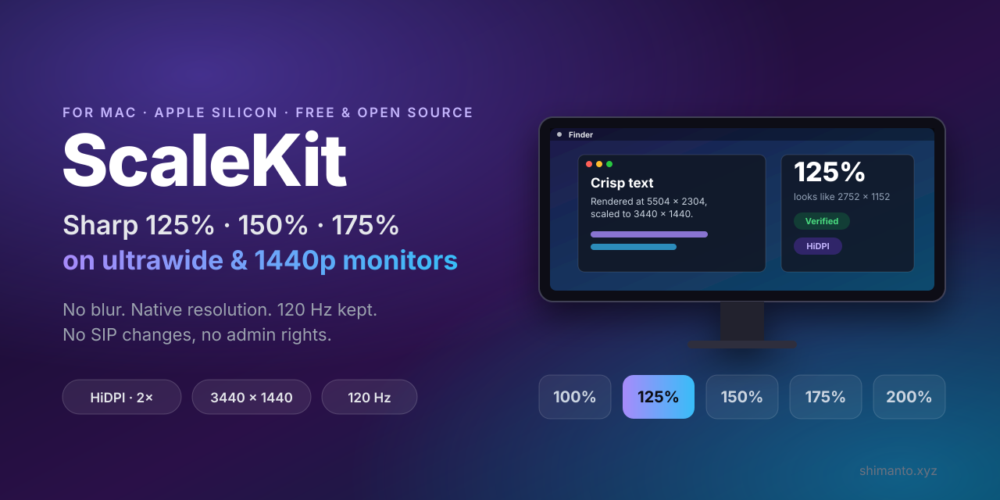
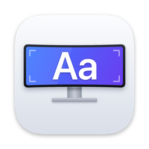
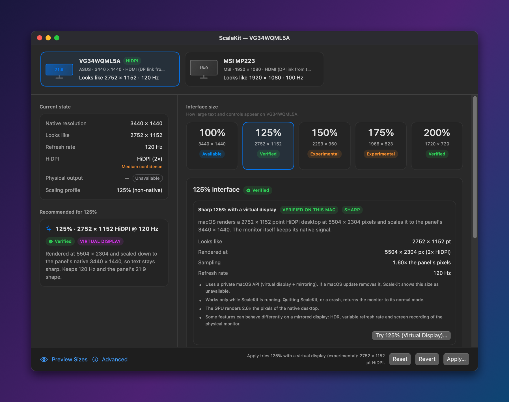
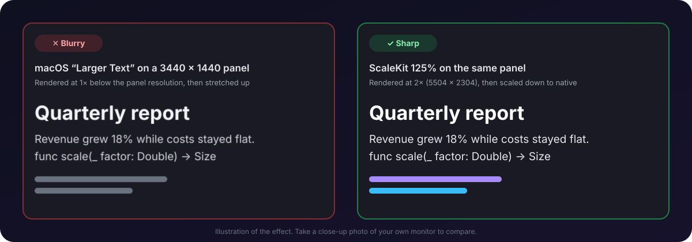
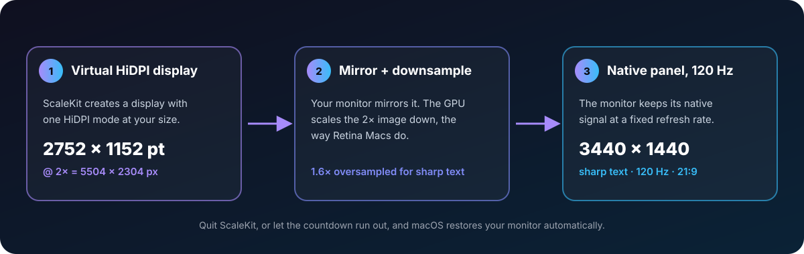
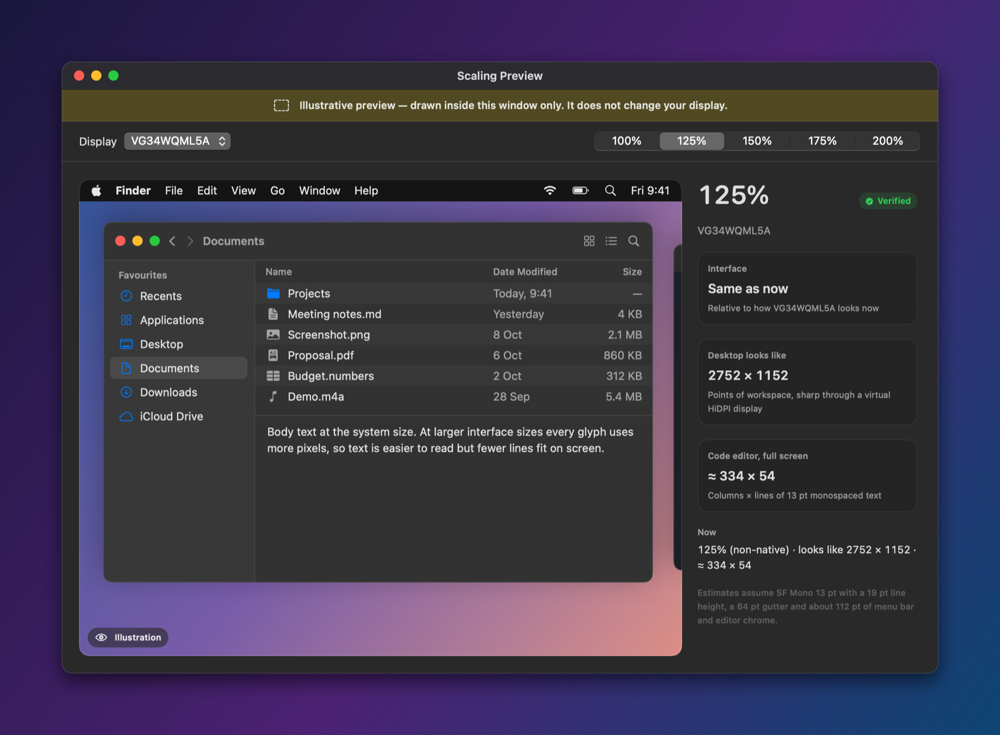
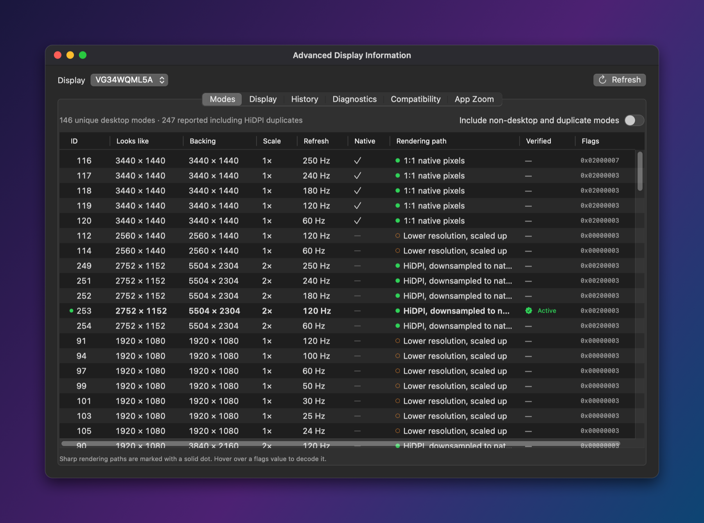
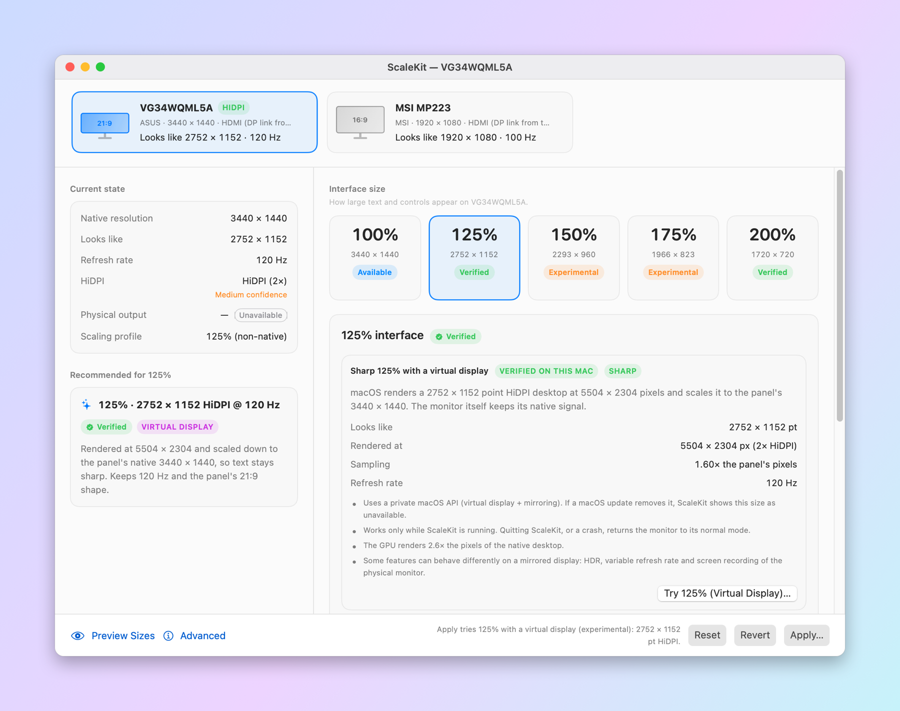
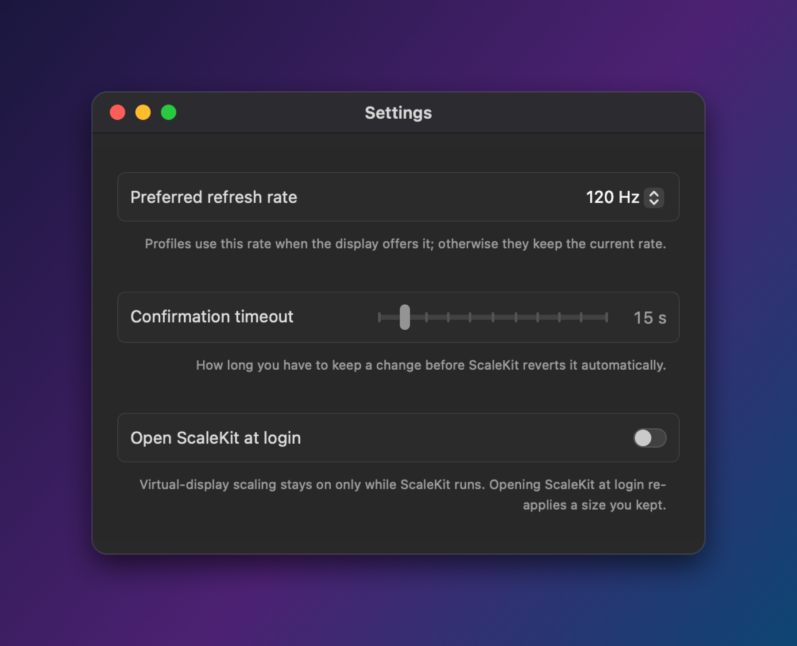

<div align="center">



#  ScaleKit

**Sharp, HiDPI scaling at 125%, 150% and 175% for ultrawide and 1440p monitors on Mac.**

Make text bigger on your external monitor **without** the blur, without giving up native resolution, and
without losing 120 Hz.

[](#requirements)
[](#requirements)
[](Package.swift)
[](LICENSE)
[](#is-it-safe)

[Download](#install) · [How it works](#how-it-works) · [FAQ](#faq) · [Docs](#documentation) · [Report your monitor](#help-other-people-with-the-same-monitor)

<br>

<picture>
  <source media="(prefers-color-scheme: light)" srcset="docs/images/screenshot-main-light.png">
  
</picture>

</div>

---

## The problem

You plug a 34″ ultrawide (3440 × 1440) or a 27″ 1440p monitor into a Mac and:

- At **100%** the text is tiny and hard to read all day.
- In **System Settings ▸ Displays**, the "Larger Text" sizes make everything **blurry**: macOS renders the desktop at
  a lower resolution and stretches it to the panel.
- The only sharp option, **200% HiDPI**, makes the interface huge. On 3440 × 1440 it looks like 1720 × 720.
- There is **no 125%, 150% or 175%** that stays sharp.

<p align="center">
  
</p>

This happens because macOS only offers sharp in-between ("scaled") HiDPI sizes on displays that Apple classifies as
high density, like Retina screens and 4K/5K monitors. A 34″ 3440 × 1440 panel is about 109 PPI, and a 27″ 1440p panel
is about 109 PPI. Neither qualifies, so macOS doesn't offer those modes at all.

ScaleKit was built to solve exactly this, for an **ASUS TUF Gaming VG34WQML5A** on a **Mac mini M4**.

## What ScaleKit does

| Interface size | Looks like (3440 × 1440 panel) | How | Sharp? | Refresh |
|---|---|---|---|---|
| 100% | 3440 × 1440 | Native mode | ✅ 1:1 pixels | 120 Hz |
| **125%** | **2752 × 1152** | Virtual HiDPI display, rendered at 5504 × 2304 | ✅ HiDPI, downsampled | 120 Hz |
| **150%** | **2293 × 960** | Virtual HiDPI display, rendered at 4586 × 1920 | ✅ HiDPI, downsampled | 120 Hz |
| **175%** | **1966 × 823** | Virtual HiDPI display, rendered at 3932 × 1646 | ✅ HiDPI, downsampled | 120 Hz |
| 200% | 1720 × 720 | macOS's own HiDPI mode | ✅ HiDPI | 120 Hz |

The same approach works for other low-density monitors. For example, a 2560 × 1440 panel at 125% looks like
2048 × 1152 and is rendered at 4096 × 2304.

Every size gets a status:

- **Verified:** applied on *your* Mac, then read back and confirmed.
- **Available:** offered by macOS but not tried yet.
- **Experimental:** needs the virtual display and hasn't been confirmed on your Mac yet.
- **Unsupported:** not possible.

ScaleKit never quietly switches you to a blurry mode.

## How it works

<p align="center">
  
</p>

1. ScaleKit creates a virtual display with exactly one HiDPI mode at the size you picked.
2. Your real monitor mirrors that display. macOS renders the desktop at 2× and the GPU scales it down to your panel.
   Rendering above the panel's resolution and scaling down keeps text sharp. Retina Macs use the same technique.
3. ScaleKit pins your monitor to a fixed refresh rate (120 Hz on the VG34WQML5A) and keeps neighbouring monitors
   where they were.

Sizes that macOS already offers sharply (100% and 200%) use macOS's own modes, with no virtual display involved.

## Is it safe?

ScaleKit was designed so that you can't get stuck with a broken screen:

- **Every change is a trial.** You review it first. Then a countdown appears on every screen. If you don't press
  **Keep Changes**, everything reverts by itself. Press **Esc** to revert immediately.
- **Changes last only while ScaleKit runs.** All changes are app-only. If ScaleKit quits, crashes or is force-quit,
  macOS removes the virtual display and restores your monitor automatically.
- **Watchdog.** A tiny helper process (`ScaleKitGuard`) ends ScaleKit if it ever hangs during a trial, which triggers
  the automatic restore.
- **No admin rights.** It doesn't touch SIP, Gatekeeper or system files, and installs no kernel extensions or
  drivers.
- **Private by design.** No network access, no accounts, no analytics. Diagnostic reports are written to disk only
  when you export them.

> **Honesty note.** The virtual display relies on one private macOS API (`CGVirtualDisplay`, the same one used by
> tools such as BetterDisplay and DeskPad). The code that uses it is isolated in a single file
> ([`SKVirtualDisplay.m`](Sources/ScaleKitVirtualBridge/SKVirtualDisplay.m)) and checked at run time. If a future
> macOS removes the API, ScaleKit shows those sizes as unavailable instead of crashing. Everything else uses public
> APIs.

## Install

### Download

1. Download **ScaleKit-<version>.zip** from [Releases](https://github.com/shimentosh/scalekit/releases) and unzip it.
2. Move **ScaleKit.app** to Applications and open it.
3. The build is not notarized yet, so the first time macOS blocks it. Open **System Settings ▸ Privacy & Security**,
   scroll down and click **Open Anyway**. (Since macOS 15, right-click ▸ Open no longer works for this.)

### Build from source

You need macOS 14+ and the Swift 6 toolchain. Xcode **or** just the Command Line Tools (`xcode-select --install`)
will do.

```sh
git clone https://github.com/shimentosh/scalekit.git
cd scalekit
scripts/build-app.sh            # → build/ScaleKit.app (release, ad-hoc signed)
scripts/build-app.sh --install  # optional: copy to ~/Applications
open build/ScaleKit.app
```

## Quick start

1. Open ScaleKit. It finds your monitors and shows what each size will look like.
2. Click a size, for example **125%**. The panel explains exactly what will happen and what it costs.
3. Click **Apply…**, review the change, then click **Try It**.
4. Look at your screen. If you like it, press **Keep Changes**; otherwise wait or press **Esc**.
5. Optional: in Settings (⌘,), turn on **Open ScaleKit at login**, so your size comes back after a restart.

You can switch or turn off scaling any time from the menu bar icon.

### Tips

- **Don't change the scaled monitor in System Settings ▸ Displays while scaling is on.** In particular, don't use
  "Optimise for", which reverses the mirror. ScaleKit detects this and turns scaling off cleanly.
- If your monitor has **Adaptive-Sync / FreeSync**, ScaleKit pins a fixed refresh rate. If you still see brightness
  pulsing, turn Adaptive-Sync off in the monitor's menu.
- Screenshots at 125% are saved at the rendered size (for example 5504 × 2304) because they capture the HiDPI desktop.
  This is normal HiDPI behaviour, just like on a Retina Mac.

## Screenshots

<table>
  <tr>
    <td width="50%"><br><sub><b>Preview each size</b> before changing anything (drawn in a window, your display isn't touched).</sub></td>
    <td width="50%"><br><sub><b>Every mode macOS reports</b>, with rendering path, refresh rate and the active one highlighted.</sub></td>
  </tr>
  <tr>
    <td width="50%"><br><sub><b>Light and dark</b>, native SwiftUI.</sub></td>
    <td width="50%"><br><sub><b>Settings:</b> preferred refresh rate, confirmation timeout, open at login.</sub></td>
  </tr>
</table>

## Features

- **Monitor overview:** native resolution, "looks like" size, backing store, physical output, refresh rate and HiDPI
  state. Every value is labelled *measured*, *inferred* or *unavailable*.
- **Interface sizes 100–200%** with honest status labels and plain-language trade-offs.
- **Transparent recommendation:** a 100-point score covering readability, native output, sharpness, refresh rate,
  aspect ratio, stability and workspace, with the reason for each component.
- **Refresh rate protection:** keeps 120 Hz and asks for explicit confirmation before any change that would lower it.
- **Display layout preserved:** monitors next to the scaled one stay where they were, and are restored afterwards.
- **Self-repair:** after sleep, wake or reconnecting a cable, the scaled setup is restored, with a rate limit so it
  never loops.
- **Illustrative preview** of each size, drawn inside a window, without touching your display.
- **Per-app zoom guide** for VS Code, browsers and terminals, clearly labelled as per-app and not system-wide.
- **Diagnostics:** an exportable Markdown + JSON report, plus a command-line tool.

## Requirements

- macOS 14 Sonoma or later. Developed and tested on macOS 27.0.
- A Mac with Apple silicon (M1, M2, M3 or M4).
- An external monitor. ScaleKit helps most on low-density panels:
  - 34″ / 35″ ultrawide at 3440 × 1440
  - 27″ at 2560 × 1440
  - 24″ at 1920 × 1080
  - 49″ super-ultrawide at 5120 × 1440

## Tested hardware

| Mac | macOS | Monitor | Result |
|---|---|---|---|
| Mac mini (M4, Mac16,10) | 27.0 | ASUS TUF Gaming VG34WQML5A 34″ 3440 × 1440, HDMI, 120 Hz | 100% ✅ · 125% ✅ (virtual, verified) · 200% ✅ · 150% / 175% experimental |
| Mac mini (M4) | 27.0 | MSI MP223 21.5″ 1920 × 1080 (second monitor) | Unaffected while the ASUS is scaled ✅ |

Tried it on another monitor? [Tell us how it went](#help-other-people-with-the-same-monitor).
Details are in [docs/COMPATIBILITY.md](docs/COMPATIBILITY.md).

## FAQ

### Why is text blurry on my external monitor on a Mac?

At "Larger Text" sizes on a non-Retina monitor, macOS renders a smaller desktop at 1× and stretches it up to the panel.
Every glyph is scaled by a non-integer factor, so it looks soft. ScaleKit renders at 2× **above** the panel's
resolution and scales down, which stays sharp.

### How do I enable HiDPI on a 1440p or ultrawide monitor on macOS?

macOS enables HiDPI in-between sizes only for displays it considers high density. ScaleKit adds them through a
virtual HiDPI display, with no `defaults write`, no display override files in `/Library`, and SIP left untouched.

### Does it work on Apple silicon Macs (M1, M2, M3, M4)?

Yes. ScaleKit is developed on an M4 Mac mini. The older "display override plist" trick that added scaled
resolutions on Intel Macs is unreliable on Apple silicon and needs admin rights; ScaleKit needs neither.

### Will I lose 120 Hz / 144 Hz?

No. ScaleKit keeps your preferred refresh rate and pins the monitor to it while scaling. Any change that would lower
it requires your explicit confirmation.

### Does it need SIP disabled or admin rights?

No, neither.

### Why does scaling stop when I quit ScaleKit?

The virtual display belongs to the ScaleKit process. That's a safety feature: if anything goes wrong, quitting
ScaleKit always restores your monitor. Turn on **Open ScaleKit at login** to keep your size.

### How is this different from BetterDisplay?

BetterDisplay is a powerful, general-purpose display tool. ScaleKit does one thing: comfortable, sharp UI sizes on an
external monitor. It does that with a safety-first workflow (review → trial → countdown → keep), honest status labels
and open source code you can audit.

### My screen looks wrong. What do I do?

Do nothing: it reverts when the countdown ends. Or press **Esc**, or quit ScaleKit (**⌘Q**). macOS restores your
monitor as soon as ScaleKit exits.

## Command-line diagnostics

```sh
swift build --product scalekit-diag
.build/debug/scalekit-diag displays                 # what macOS reports about each display
.build/debug/scalekit-diag profiles                 # 100–200% mapping and the recommendation
.build/debug/scalekit-diag virtual --check          # planned virtual sizes (read-only)
.build/debug/scalekit-diag report --out reports     # Markdown + JSON report
```

`displays`, `modes`, `profiles`, `report`, `watch` and `virtual --check` are read-only. `trial` and
`virtual --percent N` change the display through the same safety path as the app.

## Help other people with the same monitor

People searching for "blurry text on <monitor> Mac" land here. If you try ScaleKit on another monitor, please
[open an issue](https://github.com/shimentosh/scalekit/issues/new/choose) using the **Monitor report** template. Each
report adds a row to the compatibility table.

## Documentation

| Document | Contents |
|---|---|
| [FEASIBILITY.md](docs/FEASIBILITY.md) | Research: APIs, mode inventory, HiDPI findings, every hardware test result |
| [ARCHITECTURE.md](docs/ARCHITECTURE.md) | Modules, safety design, data flow |
| [TESTING.md](docs/TESTING.md) | Automated tests (236) and the manual hardware checklist |
| [COMPATIBILITY.md](docs/COMPATIBILITY.md) | Tested configurations and what to expect elsewhere |
| [KNOWN_LIMITATIONS.md](docs/KNOWN_LIMITATIONS.md) | What ScaleKit can't do, and why |

## Contributing

Bug reports, monitor reports and pull requests are welcome. See [CONTRIBUTING.md](CONTRIBUTING.md).

```sh
scripts/run-tests.sh   # 236 tests, Swift Testing
```

## Credits

Made by **Shimanto**: [shimanto.xyz](https://shimanto.xyz).

ScaleKit started because a new ultrawide monitor looked either tiny or blurry on a Mac mini, and nothing in macOS fixed
it.

## License

[MIT](LICENSE) © 2026 Shimanto
