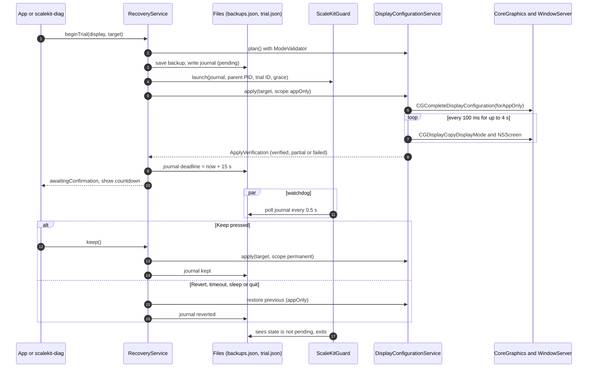

# ScaleKit Architecture

This document describes how ScaleKit is put together: the layers, each core service, the trial sequence that
applies display changes safely, and the files, logs and security boundaries involved.

Sources of truth:

- Measured facts about the hardware come from [`FEASIBILITY.md`](FEASIBILITY.md).
- Behaviour described here is read from `Sources/ScaleKitCore`, `Sources/scalekit-diag` and `Sources/ScaleKitGuard`.
  The experimental virtual-display scaling (§3.11) is read from `Sources/ScaleKitVirtual` and
  `Sources/ScaleKitVirtualBridge`.
- The SwiftUI app (`Sources/ScaleKit`) is being written in a separate workstream. This document describes only the
  contract that core gives the app, not the app's UI.
- Hardware results are recorded only in FEASIBILITY §6. That section covers diagnostics (D1) and trial mechanism tests
  T1–T7, run through `scalekit-diag trial`. The checks that need a person at the Mac (visual sharpness, sleep/wake,
  cable disconnect, logout/reboot persistence, app-by-app behaviour) are listed in [TESTING.md](TESTING.md) and are
  still pending. This document cites §6 by test ID wherever it relies on a hardware result.

## 1. Purpose

ScaleKit makes the interface larger on an external monitor (the reference is an ASUS VG34WQML5A, 3440 × 1440 at about
109 PPI) without giving up sharp text, native output, refresh rate or aspect ratio. Where that combination can't be
had, it says so.

It does this in three ways:

1. **It reports what macOS really offers.** It enumerates every display mode, including HiDPI modes, classifies each
   one, and labels every value as measured, inferred or unavailable.
2. **It maps desired sizes (100–200%) onto existing modes.** A profile is only offered when a *clean* mode exists:
   native output, sharp rendering and the panel's aspect ratio. The stable path never creates modes. The one
   exception is the opt-in experimental virtual-display scaling (§3.11), which uses a private API.
3. **It applies changes as reversible trials.** A change is made app-only, verified, shown with a countdown, and made
   permanent only when the user presses **Keep**. Five independent safety layers restore the previous mode otherwise.

App-specific zoom guidance and the in-app preview are separate, illustrative features. They are **not** system-wide
scaling (see [KNOWN_LIMITATIONS.md](KNOWN_LIMITATIONS.md)).

## 2. Layers

```
┌──────────────────────────────────────────────────────────────────────────────┐
│ Front ends                                                                   │
│   ScaleKit.app (SwiftUI + AppKit)          scalekit-diag (CLI + test harness)│
└────────────────┬───────────────────────────────────────────┬─────────────────┘
                 │        ScaleKitServices (wires services)  │
┌────────────────▼───────────────────────────────────────────▼─────────────────┐
│ ScaleKitCore services (@MainActor classes)                                   │
│   DisplayDiscoveryService   DisplayModeService   HiDPIDetectionService       │
│   ScalingProfileService     DisplayConfigurationService   RecoveryService    │
│   ConfigurationBackupService · HistoryStore · VerificationStore              │
│   DisplayEventMonitor       DiagnosticsService                               │
│ ──────────────────────────────────────────────────────────────────────────── │
│ Pure logic (nonisolated, Sendable value types; no I/O)                       │
│   ModeValidator  HiDPIDetection  ScalingProfileMapper  RecommendationEngine  │
│   VerificationEvaluator  RollbackPolicy  LaunchRecoveryPolicy                │
│   OutcomeAssessor  DiagnosticMarkdown  AppZoomGuide                          │
└────────────────┬─────────────────────────────────────────────────────────────┘
                 │ DisplayHardware protocol (the system boundary)
┌────────────────▼──────────────────────────┐
│ LiveDisplayHardware        │ test fake    │
└────────────────┬──────────────────────────┘
                 ▼
  CoreGraphics · AppKit (NSScreen) · IOKit (IORegistry)

  Direct OS access outside the boundary:
    DisplayEventMonitor  → CGDisplayRegisterReconfigurationCallback, NSWorkspace / NSApplication notifications
    SystemProfilerProbe  → /usr/sbin/system_profiler SPDisplaysDataType -json
    ProcessGuardLauncher → spawns ScaleKitGuard (Foundation.Process)

  EXPERIMENTAL, outside ScaleKitCore (§3.11):
    ScaleKitVirtual       VirtualScalingService → VirtualDisplayScaler
                          → public CG mirroring calls + SKVirtualDisplay
    ScaleKitVirtualBridge SKVirtualDisplay → private CGVirtualDisplay (NSClassFromString)
```

All reads and writes of display state go through `DisplayHardware`. A test fake can stand in for the live
implementation, so every service except the event monitor and the `system_profiler` probe can be exercised without
touching a real display.

### Executables and targets

Defined in `Package.swift` (`swift-tools-version:6.0`, platform `.macOS(.v14)`):

| Product | Target / path | Kind | Role |
|---|---|---|---|
| `ScaleKitCore` | `Sources/ScaleKitCore` | Library | Models, the `DisplayHardware` boundary, services. No UI. Links CoreGraphics, AppKit, IOKit, ColorSync. Contains the pure `VirtualScalingPlan` arithmetic but no private API. |
| `ScaleKitVirtualBridge` | `Sources/ScaleKitVirtualBridge` | Library target (Objective-C, ARC) | **EXPERIMENTAL.** `SKVirtualDisplay`, the only code that touches a private API (`CGVirtualDisplay`). |
| `ScaleKitVirtual` | `Sources/ScaleKitVirtual` | Library | **EXPERIMENTAL.** `VirtualDisplayScaler` and `VirtualScalingService`. Depends on `ScaleKitCore` and the bridge. |
| `ScaleKit` | `Sources/ScaleKit` | Executable | SwiftUI + AppKit app. Bundle ID `com.shimantoneer.ScaleKit` (`Resources/Info.plist`). |
| `scalekit-diag` | `Sources/scalekit-diag/main.swift` | Executable | Read-only diagnostics plus the hardware validation harness (`trial`, `recover`, `journal`, and the experimental `virtual`). See [TESTING.md](TESTING.md). |
| `ScaleKitGuard` | `Sources/ScaleKitGuard/main.swift` | Executable | Unprivileged watchdog, one process per trial. |
| `ScaleKitCoreTests` | `Tests/ScaleKitCoreTests` | Test target | Swift Testing suite (see [TESTING.md](TESTING.md)). Depends on `ScaleKitCore` only, so it never loads the private-API bridge. |

`scripts/build-app.sh` builds the three executables with SwiftPM and assembles `build/ScaleKit.app`:

- `Contents/MacOS/ScaleKit`
- `Contents/MacOS/ScaleKitGuard`
- `Contents/Helpers/scalekit-diag`
- `Info.plist` and `AppIcon.icns`

It ad-hoc signs the nested executables and then the bundle, and also copies `scalekit-diag` to `build/scalekit-diag`.

`ProcessGuardLauncher.locate()` looks for an executable named `ScaleKitGuard` **in the same directory as the running
executable** (`Bundle.main.executableURL`). It is found in two places:

- `.build/debug/` and `.build/release/`, where SwiftPM puts all products side by side;
- `Contents/MacOS/` inside the app bundle, for the app.

It is **not** found next to `Contents/Helpers/scalekit-diag` or `build/scalekit-diag`. Trials started from those copies
of the CLI run without the watchdog. If the guard is missing, trials still run without hang protection (layer 5
below), and this is logged.

The app's own structure is still being built. At the time of writing it has SwiftUI scenes (main window, scaling
preview, advanced information, settings, menu bar extra) over an `AppModel`. Its `AppDelegate` forwards
`applicationWillTerminate` to the model's `prepareForTermination()`.

### The system boundary: `DisplayHardware`

`Sources/ScaleKitCore/System/DisplayHardware.swift` declares a `@MainActor` protocol. `LiveDisplayHardware` implements
it:

| Method | Live implementation |
|---|---|
| `onlineDisplayIDs()` | `CGGetOnlineDisplayList` |
| `rawInfo(for:)` | `CGDisplayBounds`, `CGDisplayScreenSize`, `CGDisplayCreateUUIDFromDisplayID`, `CGDisplayVendorNumber`, `CGDisplayModelNumber`, `CGDisplaySerialNumber`, `CGDisplayIsMain`, `CGDisplayIsBuiltin`, `CGDisplayIsActive`, `CGDisplayIsInMirrorSet` |
| `currentMode(for:)` | `CGDisplayCopyDisplayMode` |
| `allModes(for:includeLowResolutionDuplicates:)` | `CGDisplayCopyAllDisplayModes` with `kCGDisplayShowDuplicateLowResolutionModes` (needed to see HiDPI modes). Per mode: `width`/`height`, `pixelWidth`/`pixelHeight`, `refreshRate`, `ioFlags`, `ioDisplayModeID`, `isUsableForDesktopGUI()` |
| `applyMode(modeID:to:scope:)` | `CGBeginDisplayConfiguration` → `CGConfigureDisplayWithDisplayMode` → `CGCompleteDisplayConfiguration` with `.forAppOnly`, `.forSession` or `.permanently`. `CGCancelDisplayConfiguration` if the configure step fails |
| `restorePermanentConfiguration()` | `CGRestorePermanentDisplayConfiguration` |
| `screenSnapshots()` | `NSScreen.screens`: `deviceDescription["NSScreenNumber"]`, `frame`, `backingScaleFactor`, `localizedName`, `maximumFramesPerSecond` |
| `registryAttributes()` | `IOServiceGetMatchingServices(kIOMainPortDefault, IOServiceMatching("IOMobileFramebuffer"))`, `IORegistryEntrySearchCFProperty` for `DisplayAttributes` and `Transport` (undocumented keys) |

Errors surface as `DisplayHardwareError`: `.displayNotFound`, `.modeNotFound`, or `.coreGraphics(operation:code:)` with
the `CGError` code translated (for example 1001 "illegal argument", 1004 "cannot complete").

## 3. Modules

Each subsection lists the module's responsibility, key types, system interactions and testing approach. Pure functions
are `static` on enums or `nonisolated static` on services, so tests can call them directly with constructed values.
Test files and results are tracked in [TESTING.md](TESTING.md).

### 3.1 DisplayDiscoveryService

`Services/DisplayDiscoveryService.swift`

- **Responsibility.** Builds one `DisplayInfo` per online display: identity, physical and logical sizes, native
  resolution, current mode, scale factor, refresh rate and connection. Every field carries its provenance. Displays
  are sorted main display first, then left to right. It also identifies the target monitor.
- **Key types.** `DisplayInfo`, `DisplayIdentity` (`persistentKey` is the CoreGraphics display UUID, or
  `vendor-product-serial` when no UUID exists), `PNPID` (decodes the 3-letter EDID manufacturer code),
  `RegistryDisplayAttributes`, `KnownMonitor.asusVG34WQML5A`, `MonitorMatch`.
- **Monitor identification** (`match(_:in:)`). EDID manufacturer `AUS` scores +1, product ID `0x342B` +1, and a name
  containing `VG34WQML5A` +2. A total of 3–4 is High confidence, 2 Medium, 1 Low. Native-resolution agreement with the
  specification is reported as a reason but doesn't add to the score.
- **System interactions.** Only through `DisplayHardware` (`onlineDisplayIDs`, `rawInfo`, `screenSnapshots`,
  `registryAttributes`) and `DisplayModeService`. IORegistry entries are matched to displays by
  `LegacyManufacturerID` and `ProductID`.
- **Testing.** `makeInfo(raw:currentMode:allModes:screen:registry:)` and `match(_:in:)` are pure. `discover()` runs
  against `FakeDisplayHardware` (`Tests/ScaleKitCoreTests/Support/`).

### 3.2 DisplayModeService and ModeValidator

`Services/DisplayModeService.swift`

- **Responsibility.** Reads, filters, deduplicates and sorts modes, and determines native resolution. `ModeValidator`
  checks a proposed mode before anything is applied.
- **Key types.** `DisplayModeInfo` (points, pixels, refresh, `DisplayModeFlags`, desktop-usable),
  `DisplayModeFlags` (values copied from `IOKit/graphics/IOGraphicsTypes.h`, including `native` = `0x02000000`),
  `ModeSignature` (logical size, pixel size and refresh in mHz; used instead of mode IDs, which can change across
  reconnects), `RefreshComparison` (0.5 Hz tolerance), `ModeValidation`.
- **Rules.**
  - `allModes` always requests low-resolution duplicates, because HiDPI modes are only listed with that option.
  - `desktopModes` keeps modes that are `isUsableForDesktopGUI` and carry the `valid` flag. Duplicates (same signature)
    are collapsed, keeping the default-flagged entry first and then the lowest mode ID.
  - `nativeResolution` takes the largest backing size among modes flagged `kDisplayModeNativeFlag` (*measured*). If no
    mode has the flag, it falls back to the largest 1× mode (*inferred*). The IORegistry `NativeFormatHorizontalPixels`
    key is not used, because on the reference monitor it reports 1920 × 1080 (FEASIBILITY §1).
- **ModeValidator.**

  | Blocks the change (errors) | Must be shown to the user (warnings) |
  |---|---|
  | Mode not currently offered (ID + signature) | Interlaced mode |
  | Not usable for desktop GUI | Refresh-rate reduction (also sets `requiresRefreshConfirmation`) |
  | Missing `valid` flag | Refresh rate after the change unknown |
  | `neverShow` flag | Aspect ratio differs from the panel |
  | Mode already active | Not flagged native, so physical output is not reported |
  | | Upscaled rendering (soft text) |
  | | Workspace below 30% of native area |

- **System interactions.** `DisplayHardware.currentMode` and `allModes` only.
- **Testing.** `desktopModes(from:)`, `deduplicated`, `sorted`, `nativeResolution(from:)` and
  `ModeValidator.validate` are pure functions over `DisplayModeInfo` arrays. Tests: `ModeValidationTests.swift`,
  `RefreshRateTests.swift`.

### 3.3 HiDPIDetectionService

`Services/HiDPIDetectionService.swift`

- **Responsibility.** Classifies how each mode renders relative to the panel, reports whether the active mode is
  HiDPI, and summarizes which HiDPI modes exist.
- **RenderingPath** (`HiDPIDetection.renderingPath(for:native:)`):

  | Path | Condition | Sharp? |
  |---|---|---|
  | `native1x` | Backing = panel, 1× | Yes |
  | `nativeHiDPI` | Backing = panel, scale > 1.01 | Yes |
  | `supersampledHiDPI` | HiDPI backing ≥ panel in both dimensions (downsampled) | Yes |
  | `upscaledHiDPI` | HiDPI backing smaller than the panel | No |
  | `upscaled1x` | 1× backing smaller than the panel | No |
  | `unknown` | Native unknown, or a 1× backing larger than the panel | No |

- **HiDPIStatus confidence.** CoreGraphics mode scale and `NSScreen.backingScaleFactor` agree (within 0.01): High.
  CoreGraphics only: Medium. The two disagree, or only AppKit reports: Low. Neither reports: None.
- **HiDPIAvailability.** Lists native HiDPI modes (backing = panel *and* native flag), supersampled HiDPI modes and
  aspect-matched HiDPI modes. It says explicitly when no scaled HiDPI modes with the panel's shape exist, which is the
  situation on the reference monitor (FEASIBILITY §5).
- **System interactions.** `DisplayHardware.screenSnapshots` plus `DisplayModeService`.
- **Testing.** `HiDPIDetection.renderingPath`, `availability` and `status` are pure.

### 3.4 ScalingProfileService, ScalingProfileMapper and RecommendationEngine

`Services/ScalingProfileService.swift`, `Services/RecommendationEngine.swift`, `Models/Profiles.swift`

- **Responsibility.** Maps the standard targets (100, 125, 150, 175, 200%) onto the modes macOS offers, assigns a
  status, and ranks modes with a transparent score.
- **Definitions.**
  - *UI scale* = native width ÷ mode logical width (3440 ÷ 1720 = 2.0 → 200%).
  - *Clean* mode (`ModeAssessment.isClean`) = native flag **and** a sharp rendering path **and** the panel's aspect
    ratio (1.5% tolerance).
  - *Reference refresh* (`EvaluationContext.referenceRefresh`) is the preferred refresh rate (120 Hz by default in the
    CLI) if any desktop mode offers it. Otherwise it is the current refresh rate.
- **ScalingProfileMapper rules.**
  1. A target is mapped only to a clean mode whose UI scale is within 3% of the target (`profileTolerance = 0.03`).
  2. Among clean candidates it picks the exact reference refresh first, then the lowest rate above it, then the
     highest rate below it.
  3. Status is **Verified** if a `VerificationRecord` exists for that mode signature on this display, or if the mode is
     currently active. Otherwise it is **Available**.
  4. If no clean mode exists, the status is **Unsupported**. Up to three aspect-correct alternatives (one per
     resolution, best score first) are listed with their trade-offs. Alternatives are **never applied automatically**.
  5. If native resolution is unknown, every target is **Unknown**. **Experimental** exists in `SupportStatus` but the
     mapper never assigns it. The opt-in virtual-display scaling (§3.11) is offered next to an Unsupported profile
     and doesn't change its status.
- **RecommendationEngine weights** (100 points total, priority order readability → native output → HiDPI → refresh →
  aspect → stability → workspace):

  | Criterion | Max | How points are earned |
  |---|---|---|
  | Readability | **25** | `25 × max(0, 1 − penalty)`. Relative error vs the desired size. Too small is penalized ×3, too large ×1.5. |
  | Native output | **20** | 20 if the mode carries `kDisplayModeNativeFlag`, else 0. |
  | Sharpness / HiDPI | **15** | Native HiDPI 15 if verified on this Mac, 10 if not. Supersampled HiDPI 13 / 8. Native 1× 8. Upscaled HiDPI 3. Upscaled 1× 0. Unknown 0. |
  | Refresh rate | **15** | 15 if unchanged or higher. `15 × new/old` if lower. 7.5 if unknown. |
  | Aspect ratio | **10** | 10 if it matches the panel, else 0. |
  | Stability | **10** | +4 desktop-usable, +3 `valid`+`safe` flags, +1 neither interlaced nor stretched, +2 verified on this Mac. |
  | Workspace | **5** | `5 × min(1, logical area ÷ native area)`. |

- **Why a blurry mode can't outrank a sharp native one.** Native output and sharpness together give any native-flagged,
  sharp mode at least 20 + 8 = 28 points. An upscaled 1× mode without the native flag earns 0 from both. Readability is
  capped at 25, so a soft mode can't make up the gap through size alone when shape and refresh rate are the same.
  Stability and workspace can shift a few points either way, so the scores alone are a strong bias, not a proof. The
  hard guarantees are structural:
  - Profiles only ever select clean modes.
  - `Recommendation.meetsAllCriteria` requires a clean mode with no refresh reduction.
  - `recommend` only considers modes with the panel's aspect ratio when any exist.

  Separately, an unverified mode scores lower than the same mode once it has been verified (sharpness and stability).
- **Tie-breaking.** `rank` orders by total score, then clean before non-clean, then by refresh preference relative to
  the reference rate (`RecommendationEngine.refreshPreference`: exact match first, then the nearest higher rate, then
  the nearest lower rate), then by lowest mode ID. Without the refresh step, an unchanged and a higher refresh rate both
  score 15, and a 250 Hz variant would win over the user's 120 Hz. `ScalingProfileMapper` uses the same
  `refreshPreference` key, so the recommendation and the 200% profile pick the same mode (1720 × 720 HiDPI @ 120 Hz on
  the reference monitor), and `Recommendation.profile` is set.
- **System interactions.** None directly. `ScalingProfileService` reads desktop modes via `DisplayModeService` and
  verified signatures via `VerificationStore`.
- **Testing.** `ScalingProfileMapper.evaluate`, `RecommendationEngine.assess`, `rank`, `recommend` and
  `EvaluationContext.referenceRefresh` are pure. The ASUS fixture follows the mode list in FEASIBILITY §4. Tests:
  `ProfileMappingTests.swift`, `RecommendationTests.swift`.

### 3.5 DisplayConfigurationService and VerificationEvaluator

`Services/DisplayConfigurationService.swift`

- **Responsibility.** Builds the before/after `ChangePlan` shown to the user, applies a mode with a given
  `ConfigurationScope`, and verifies the result. This service never decides *whether* to change anything. Callers go
  through `RecoveryService`.
- **ChangePlan rows.** Interface size, Looks like, Rendered at, Physical output, Text rendering, Refresh rate, Aspect
  ratio. Validation comes from `ModeValidator`.
- **Verification.** After `applyMode`, `verify` polls every `pollInterval` (100 ms) until the result is `verified` or
  `verificationTimeout` (4 s) passes. Each poll re-reads `CGDisplayCopyDisplayMode` (through `DisplayHardware`) and
  the `NSScreen` snapshot. `VerificationEvaluator` assigns a level:

  | Level | Meaning |
  |---|---|
  | `verified` | CoreGraphics reports the requested signature **and** AppKit reports the expected `backingScaleFactor` (±0.01) and `frame` size. |
  | `partial` | CoreGraphics reports the requested signature, but AppKit has no screen for the display or disagrees on scale or size. |
  | `failed` | CoreGraphics returned no mode, or a different mode. |

  When `useSecondaryProbe` is on (the CLI `trial` command turns it on), `system_profiler SPDisplaysDataType -json` is
  run as an extra *inferred* cross-check. It never changes the level. The probe is limited to 6 s. If it overruns, it
  is terminated and the cross-check is reported as unavailable. This limit was added after an unexplained stall during
  hardware testing (FEASIBILITY §6, T5a).

  On hardware, a mode change was verified in about 1.2 s on the MSI display (T1). The 200% HiDPI mode on the ASUS was
  verified by CoreGraphics, AppKit and `system_profiler` together (T6).
- **System interactions.** `DisplayHardware.applyMode`, `currentMode`, `screenSnapshots`, and `SystemProfilerProbe`.
- **Testing.** `VerificationEvaluator.evaluate` is pure. `apply` and `verify` run against `FakeDisplayHardware`. It
  can switch modes immediately, ignore the request (`ignoresApply`), throw (`applyError`), or report no AppKit screen.
  `verificationTimeout` and `pollInterval` are settable to keep tests fast. Tests: `RecoveryServiceTests.swift`
  (indirectly).

### 3.6 ConfigurationBackupService, HistoryStore and VerificationStore

`Services/ConfigurationBackupService.swift`, `Support/Support.swift` (`JSONFileStore`)

- **Responsibility.** Local persistence of three kinds of record: the pre-change mode, the change history, and proof
  that a mode was applied and read back.
- **Key types.** `DisplayStateRecord` (one per display, keyed by `DisplayIdentity.persistentKey`), `HistoryEntry` (kinds
  `backupSaved`, `trialStarted`, `applyFailed`, `verificationFailed`, `kept`, `reverted`, `autoReverted`, `recovered`,
  `abandoned`, `superseded`), `VerificationRecord` (signature, date, OS summary, hardware model, observed scale,
  method).
- **Failure semantics.**
  - `ConfigurationBackupService.save` **throws**. `RecoveryService` refuses to change the display if the backup can't
    be written.
  - `HistoryStore.append` and `VerificationStore.record` log errors and continue. Losing a history line must never
    block a revert.
  - `HistoryStore` keeps the newest 200 entries.
  - `VerificationStore` keeps one record per display and signature.
- **System interactions.** Files only (see §7). All writes are atomic (`Data.write(options: .atomic)`) and use
  pretty-printed, sorted-key JSON with ISO 8601 dates (`JSONCoding`).
- **Testing.** Each store takes a file URL (and the backup service takes an injectable clock), so tests use a temporary
  directory. Tests: `BackupTests.swift`.

### 3.7 RecoveryService

`Services/RecoveryService.swift`, plus `Sources/ScaleKitGuard/main.swift`

- **Responsibility.** Runs every display change as a reversible trial, decides what happens on each event, and cleans
  up after crashes, hangs and restarts.
- **Five safety layers** (documented in the source):
  1. **Backup.** The previous mode is saved to `backups.json` before anything changes.
  2. **Journal.** A `TrialJournal` (`trial.json`, state `pending`, app PID, previous and target mode, deadline) is
     written before the change, so a crash or restart can be detected at launch.
  3. **App-only apply.** The trial uses `kCGConfigureForAppOnly`. The SDK documents that WindowServer reverts such
     changes when the process terminates, including crashes and force quits (FEASIBILITY §2).
  4. **Countdown.** Unless the user presses Keep before the deadline (`confirmationTimeout`, default 15 s), the change
     is reverted.
  5. **Watchdog.** `ScaleKitGuard` terminates ScaleKit if it is still pending past deadline + `guardGrace` (default
     8 s), which triggers layer 3. It then restores the permanent configuration if needed.
- **State machine** (`RecoveryService.State`, phase `TrialPhase`):

  ```mermaid
  stateDiagram-v2
      [*] --> idle
      idle --> finished: validation, backup or journal failure (nothing changed)
      idle --> applying: beginTrial
      applying --> awaitingConfirmation: verification verified or partial
      applying --> finished: apply or verification failed (previous mode restored)
      awaitingConfirmation --> applying: Keep, Revert, timeout, sleep, quit
      awaitingConfirmation --> finished: display removed (abandoned) or external change (superseded)
      applying --> finished: kept or reverted
      finished --> applying: next beginTrial
  ```

  `beginTrial` is ignored while `isBusy` (`applying` or `awaitingConfirmation`). `handle(_:)` acts only while a session
  is awaiting confirmation, so duplicate events after resolution do nothing.

- **RollbackPolicy** (`RollbackPolicy.decide(_:phase:)`). In any phase other than `awaitingConfirmation`, every event
  is `ignore`.

  | `TrialEvent` | Decision | Journal state | History kind |
  |---|---|---|---|
  | `userKept` | `keep`: re-apply the target with `.permanent`, verify | `kept` | `kept` |
  | `userReverted` | `revert` ("You chose Revert.") | `reverted` | `reverted` |
  | `timerExpired` | `revert` ("not confirmed in time") | `reverted` | `autoReverted` |
  | `systemWillSleep` | `revert` | `reverted` | `autoReverted` |
  | `appTerminating` | `revert` | `reverted` | `autoReverted` |
  | `targetDisplayRemoved` | `abandon`: nothing to restore now | `abandoned` | `abandoned` |
  | `targetDisplayChangedExternally` | `supersede`: stop without touching the display | `superseded` | `superseded` |

  If the permanent apply on Keep throws or fails verification, the trial is reverted automatically.
  `prepareForTermination()` is the synchronous path for `applicationWillTerminate`. It marks the journal
  `revertedBySystem` and relies on WindowServer's app-only revert at exit.

  Mapping `DisplayEvent`s (sleep, display removal, external mode changes) to `TrialEvent`s is the front end's job.
  `scalekit-diag trial` prints events but does **not** feed them to `RecoveryService`.
- **Restoring.** `restoreIfNeeded` does nothing if the previous signature is already active. Otherwise it finds the
  previous mode by signature (mode IDs can change) and applies it with `.appOnly` (`.permanent` during launch
  recovery). If that fails, it calls `CGRestorePermanentDisplayConfiguration` and verifies again.
- **LaunchRecoveryPolicy** (`assess(journal:currentPID:isProcessAlive:currentMode:displayConnected:)`). This handles a
  journal left in `pending` or `abandoned`. Any other state needs no action.

  | Assessment | Condition | Action in `recoverAfterLaunch` |
  |---|---|---|
  | `ownedByRunningInstance` | `pending`, PID ≠ current and still alive (`kill(pid, 0)`) | None |
  | `displayMissing` | Display not connected | Journal → `abandoned`, checked again later |
  | `previousModeActive` | macOS already reverted | Journal → `revertedBySystem`, history `recovered` |
  | `trialModeStillActive` | Unconfirmed mode still active | Restore previous with `.permanent`, journal → `reverted`, history `recovered` |
  | `otherModeActive` | Neither mode active | Journal → `superseded`, display left unchanged |

- **ScaleKitGuard.** Started by `ProcessGuardLauncher` with
  `--journal PATH --parent PID --trial UUID --grace S --log PATH`. It calls `setsid()` and ignores `SIGINT` and `SIGHUP`,
  so a Ctrl-C in the terminal doesn't stop it with its parent. Every 0.5 s it:
  - exits if the journal is missing, belongs to another trial, or is no longer `pending`;
  - if the parent has exited: waits 1 s, restores if needed (`CGRestorePermanentDisplayConfiguration` when the
    previous mode isn't active), marks the journal `revertedBySystem` and exits;
  - if the deadline + grace has passed: sends `SIGTERM`, waits up to 2 s, sends `SIGKILL` if needed, restores if
    needed, marks the journal `revertedByGuard` and exits;
  - stops unconditionally after 15 minutes.

  It runs as the same user with no entitlements and writes plain-text lines to `guard.log`. While `beginTrial` is
  still applying and verifying, the journal deadline is a provisional `confirmationTimeout + 10 s`, so a hang during
  verification is also covered.
- **System interactions.** `DisplayConfigurationService` (apply/verify), `CGRestorePermanentDisplayConfiguration`
  (via `DisplayHardware`), `getpid`, `kill(pid, 0)`, `Foundation.Process` for the guard, and the files in §7.
- **Testing.** `RollbackPolicy.decide` and `LaunchRecoveryPolicy.assess` are pure. They take the process-liveness check
  as a closure. `RecoveryService` takes a fake `DisplayHardware` (through `DisplayConfigurationService`), a fake
  `GuardLauncher`, temporary file URLs and an injectable `now`. `confirmationTimeout` and `guardGrace` are settable.
  Tests: `RollbackPolicyTests.swift`, `RecoveryServiceTests.swift`. The guard process and WindowServer's app-only
  revert can only be checked on hardware. FEASIBILITY §6 records the harness runs:
  - T1: Revert.
  - T2: exit without reverting → `revertedBySystem`.
  - T3: `kill -9`.
  - T4: hang → `SIGTERM` 8 s after the deadline → `revertedByGuard`.
  - T5: Keep persisted after exit.

  T1–T5 changed the refresh rate of the secondary MSI display. TESTING.md §3 lists the remaining manual checks.

### 3.8 DisplayEventMonitor

`Services/DisplayEventMonitor.swift`

- **Responsibility.** Reports display connect, disconnect, mode, arrangement, sleep, wake and power-off events to
  registered handlers on the main actor. Keeps the last 100 events for diagnostics.
- **Key types.** `DisplayEvent` (`reconfigured(displayID:changes:)`, `screenParametersChanged`, `systemWillSleep`,
  `systemDidWake`, `screensDidSleep`, `screensDidWake`, `systemWillPowerOff`). `DisplayChangeSet` decodes
  `CGDisplayChangeSummaryFlags` (`beginConfiguration`, `moved`, `setMain`, `setMode`, `added`, `removed`, `enabled`,
  `disabled`, `mirror`, `unmirror`, `desktopShapeChanged`). `isPreflight` marks the "before" callback, which carries no
  state. `RecordedDisplayEvent`.
- **System interactions.**
  - `CGDisplayRegisterReconfigurationCallback` / `CGDisplayRemoveReconfigurationCallback`.
  - On `NSWorkspace.shared.notificationCenter`: `willSleepNotification`, `didWakeNotification`,
    `screensDidSleepNotification`, `screensDidWakeNotification`, `willPowerOffNotification`.
  - On `NotificationCenter.default`: `NSApplication.didChangeScreenParametersNotification`.
- **Lifetime.** The C callback receives the monitor through `Unmanaged.passUnretained`, so the monitor must outlive its
  registration. `ScaleKitServices` owns it for the life of the process. Call `stop()` before releasing it.
- **Testing.** `emit(_:)` is public so tests and tools can inject events. `DisplayChangeSet` decoding is pure. The live
  callback and notifications need real hardware (connect, disconnect, sleep).

### 3.9 DiagnosticsService and OutcomeAssessor

`Services/DiagnosticsService.swift`

- **Responsibility.** Produces a complete, exportable `DiagnosticReport` and answers "can each of my goals be met on
  this display?"
- **OutcomeAssessor.** Seven outcomes per display, each `achievedNow`, `achievable`, `partiallyAchievable`,
  `notAchievable` or `unknown`:
  1. Native physical output
  2. Reference refresh at native output
  3. Correct aspect ratio
  4. HiDPI text at native output
  5. Larger interface with sharp text
  6. 125/150/175% with sharp text
  7. All of these together
- **Report contents** (`DiagnosticReport`, `formatVersion: 1`): generation time, ScaleKit version (`0.1.0`),
  `EnvironmentInfo` (macOS version and build, `hw.model`, chip, memory, architecture), preferred refresh, desired size
  (default 150%), target-monitor match, and per display:
  - facts with provenance;
  - HiDPI status and availability;
  - total and desktop mode counts and the full desktop mode table;
  - profile evaluations;
  - the recommendation with its score breakdown;
  - outcome assessments;
  - the `system_profiler` cross-check.

  The report also includes all verification records and recent events.
- **Formats.**
  - `DiagnosticsService.write(_:to:basename:)` writes `<basename>.md` (rendered by `DiagnosticMarkdown`, with an
    M/I/U provenance legend) and `<basename>.json` (the Codable report) into the given directory. The default basename
    is `scalekit-diagnostics-yyyy-MM-dd'T'HH-mm-ss`.
  - `scalekit-diag report` prints the Markdown to stdout, or writes both files with `--out DIR`.
  - `--no-profiler` skips `system_profiler`.
- **System interactions.** Through the other services, plus `SystemProfilerProbe` and `sysctlbyname` (via
  `EnvironmentInfo.current()`).
- **Testing.** `OutcomeAssessor.assess` and `DiagnosticMarkdown.render` are pure. A report can be built against a fake
  hardware object with `includeSystemProfiler: false`.

### 3.10 Supporting pieces

- **ScaleKitServices** builds the service graph once per process (app, CLI, guard or test). `ScaleKitServices.live()`
  uses `LiveDisplayHardware`, `AppPaths.standard()` and `ProcessGuardLauncher.locate()`. The guard builds its own
  instance with `guardLauncher: nil`.
- **AppZoomGuide** is static, per-app text-size guidance (VS Code, Safari, Chrome, Firefox, Terminal, iTerm2, Finder,
  the macOS Text Size setting). Each tip carries a `scope` string such as "VS Code windows only". It is not scaling and
  never changes the display.
- **SystemProfilerProbe** runs `/usr/sbin/system_profiler SPDisplaysDataType -json` on a detached utility-priority
  task with a 6 s timeout (`run(timeout:)`). On timeout the process is terminated and `nil` is returned. It parses
  `spdisplays_ndrvs`, `_spdisplays_displayID`, `_spdisplays_pixels` and `_spdisplays_resolution`. These keys are
  undocumented, so results are *inferred* corroboration only. On hardware, `_spdisplays_pixels` reported the backing
  or render size, not the link timing (FEASIBILITY §6, T6 and T7).

### 3.11 Experimental: virtual-display scaling

`Services/VirtualScaling.swift` (core), `Sources/ScaleKitVirtual`, `Sources/ScaleKitVirtualBridge`

- **Responsibility.** Produce HiDPI sizes macOS doesn't offer (125/150/175% on a low-density monitor) by mirroring the
  monitor to a virtual display that has the wanted HiDPI mode. Opt-in, and only while ScaleKit runs. Facts and open
  questions are in FEASIBILITY §11.
- **Key types.**
  - `VirtualScalingPlan` (core, pure): for a target in 105–195% and the panel's native size, the "looks like" size
    (native width ÷ scale, height from the panel's aspect ratio), a backing store of exactly twice that, `sampling`,
    `renderLoad`, `modeInfo` (mode ID −1, for journals and history) and the trade-off text. Returns `nil` for 100% and
    200%, out-of-range targets, non-positive sizes or refresh, and backing stores above 8192 px.
  - `VirtualScalingPreference` (core): display key, name, percentage and date, saved on Keep.
  - `VirtualTrialLaunchPolicy.needsClosing` (core, pure): a `pending` virtual journal whose process is gone needs
    only closing, because macOS removed the virtual display when that process exited.
  - `SKVirtualDisplay` (bridge, Objective-C): checks every private class and selector (`isSupported`), creates a
    virtual display with `hiDPI = 1` and one mode, exposes its `CGDirectDisplayID`, and reports termination. Vendor ID
    `0x534B` ("SK") marks ScaleKit's virtual displays. The app and `scalekit-diag virtual` leave them out of their
    display lists (`VirtualDisplayScaler.isScaleKitVirtualDisplay`); core discovery and the other CLI commands don't.
  - `VirtualDisplayScaler` (`@MainActor`): creates the virtual display, polls up to 6 s for the HiDPI mode, then in one
    transaction selects that mode, places the virtual display at the monitor's origin and mirrors the monitor to it
    (`CGConfigureDisplayMirrorOfDisplay`), completed with `kCGConfigureForAppOnly`. Verification requires mirroring,
    the planned points and pixels from CoreGraphics, and `backingScaleFactor` 2 from AppKit. Any failure tears
    everything down; if the monitor isn't back in its previous mode, it calls `CGRestorePermanentDisplayConfiguration`.
    `reassertMirrorIfNeeded()` re-mirrors after wake.
  - `VirtualScalingService` (`@MainActor`): the confirm-or-revert flow.
- **Safety layers compared with §3.7.**
  1. **Backup:** not used. Nothing is written to the display preferences, so there is nothing to back up.
  2. **Journal:** `virtual-trial.json`, a `TrialJournal` whose target is `plan.modeInfo`, written before anything
     changes. A trial doesn't start if it can't be written.
  3. **App-only:** the mirror configuration and the virtual display both end with ScaleKit's process (FEASIBILITY §11,
     V4).
  4. **Countdown:** `confirmationTimeout` (default 15 s) turns the scaling off unless kept.
  5. **Watchdog:** the same `ScaleKitGuard`, given the virtual journal. Ending a hung ScaleKit removes the virtual
     display.
- **Keep** marks the journal `kept`, saves `virtual-scaling.json` and leaves the scaling running. At launch,
  `restoreAtLaunch` closes a stale pending journal and re-applies the saved preference if the display is connected and
  the API is available. A user turn-off deletes the preference. Automatic turn-offs (timeout, sleep during a trial,
  disconnect) don't.
- **Events.** Disconnect of the mirrored monitor turns the scaling off. System sleep turns off a pending trial only.
  Wake re-asserts mirroring.
- **Testing.** `VirtualScalingPlan`, `VirtualScalingPreference` and `VirtualTrialLaunchPolicy` are covered by
  `VirtualScalingTests.swift`. `ScaleKitVirtual` and the bridge have no automated tests: they need a real
  WindowServer, and the test target doesn't depend on them. They are covered by `scalekit-diag virtual` and the
  manual checklist (TESTING.md §2.6, §3.7).

## 4. Trial sequence

What `RecoveryService.beginTrial(on:to:acceptRefreshReduction:)` and its follow-ups do, in order. Steps 1–5 change
nothing on screen. A failure in any of them ends the trial with `.failed` and the display untouched.

1. **Validate.** `DisplayConfigurationService.plan` → `ModeValidator`. Any error stops here.
2. **Refresh gate.** If the change lowers the refresh rate and `acceptRefreshReduction` is false, stop with "Confirm
   the refresh-rate reduction to continue."
3. **Back up.** `ConfigurationBackupService.capture` + `save` → `backups.json`. History: `backupSaved`.
4. **Journal.** Write `TrialJournal(state: pending, appPID, previous, target, deadline = now + timeout + 10 s)` to
   `trial.json`.
5. **Guard.** Launch `ScaleKitGuard`. If it can't be launched, log a notice and continue (layers 1–4 still apply).
6. **Apply, app-only.** State `applying`. History: `trialStarted`. `CGBeginDisplayConfiguration` →
   `CGConfigureDisplayWithDisplayMode` → `CGCompleteDisplayConfiguration(.forAppOnly)`. If this throws: restore,
   journal `reverted`, history `applyFailed`, finished `.failed`.
7. **Verify.** Poll CoreGraphics and AppKit for up to 4 s. `failed`: restore, journal `reverted`, history
   `verificationFailed`, finished `.failed`. `verified`: write a `VerificationRecord` (this is what turns a profile from
   Available into Verified). `partial`: continue, but don't record verification.
8. **Countdown.** Deadline = now + `confirmationTimeout` (15 s by default). Update the journal and enter
   `awaitingConfirmation(session)`. Start the timer task. The front end shows the countdown with Keep and Revert.
9. **Resolve.**
   - **Keep:** re-apply the target with `CGCompleteDisplayConfiguration(.permanently)` and verify. Journal `kept`,
     history `kept`. On failure, revert automatically.
   - **Revert, timeout, sleep or quit:** restore the previous mode (app-only, falling back to
     `CGRestorePermanentDisplayConfiguration`). Journal `reverted`, history `reverted` or `autoReverted`.
   - **Display removed:** journal `abandoned`. Reconciled at next launch or reconnect.
   - **Changed elsewhere:** journal `superseded`. The display is not touched.
10. **If ScaleKit crashes or is killed** at any point after step 6, WindowServer reverts the app-only change. The guard
    (or the next launch's `recoverAfterLaunch`) records `revertedBySystem`. **If ScaleKit hangs**, the guard terminates
    it after deadline + 8 s and records `revertedByGuard`.



## 5. Provenance model

Every reported value is a `Fact<Value>` (`Models/Fact.swift`): `value`, `provenance` and `source`. `source` is the API
for measured values, the reasoning for inferred ones, or why the value is unavailable.

| Provenance | Meaning | CLI tag / report code |
|---|---|---|
| **Measured** | Read directly from a public API for the current state | `[M]` / `M` |
| **Inferred** | Derived from measured values, or read from an undocumented source (IORegistry keys, `system_profiler` JSON) | `[I]` / `I` |
| **Unavailable** | macOS doesn't expose it | `[U]` / `U` |

The `Fact` initializer forces `unavailable` whenever `value` is nil, so a missing value can't be labelled measured.

| Field | Provenance and source |
|---|---|
| Name | Measured (`NSScreen.localizedName`), else inferred (IORegistry `ProductName`) |
| Manufacturer | Inferred (PNP decode of `CGDisplayVendorNumber`) |
| Physical size | Measured (`CGDisplayScreenSize`, from EDID) |
| Pixel density | Inferred (native width ÷ physical width) |
| Native resolution | Measured (largest `kDisplayModeNativeFlag` mode), else inferred (largest 1× mode) |
| Logical size / backing size | Measured (`CGDisplayModeGetWidth/Height`, `GetPixelWidth/Height`) |
| Physical output | Inferred from the native flag. Otherwise unavailable, because no public API reports link timing |
| Backing scale | Measured (`NSScreen.backingScaleFactor`), else inferred from the CG mode |
| Refresh rate | Measured (`CGDisplayModeGetRefreshRate`). Unavailable when it reports 0 Hz |
| Connection, EDID refresh range, VRR, HDR | Inferred (IORegistry `Transport` / `DisplayAttributes`) |

Two other labels are separate from provenance:

- `SupportStatus` (Verified / Available / Experimental / Unsupported / Unknown) describes a scaling *profile*.
- `Confidence` (None / Low / Medium / High) describes HiDPI detection and monitor identification.

## 6. Concurrency model

- **Swift 6 language mode.** The package uses tools version 6.0, so targets build with complete concurrency checking.
- **Main actor for state and system calls.** `DisplayHardware`, `LiveDisplayHardware` and every service class are
  `@MainActor`. CoreGraphics configuration and AppKit's `NSScreen` are main-thread oriented, and keeping all mutable
  state on one actor avoids locks.
- **Pure logic is nonisolated.** Validators, mappers, policies and renderers are `static` functions over `Sendable`
  value types, so they are deterministic and testable from any context.
- **C callback hop.** `CGDisplayRegisterReconfigurationCallback` delivers to a capture-free static closure. On the main
  thread it calls `MainActor.assumeIsolated { emit }`. Otherwise it hops with `Task { @MainActor in emit }`.
  Notification observers use `queue: .main` and `MainActor.assumeIsolated`.
- **Async verification polling.** `apply` and `verify` are `async`. The poll loop uses `Task.sleep(for:)`, which yields
  the main actor between reads so AppKit can process the screen-parameter change that updates `NSScreen`. For the same
  reason `scalekit-diag` runs a full `NSApplication` run loop (activation policy `.prohibited`, no Dock icon or window)
  instead of a bare command-line loop.
- **Countdown.** A main-actor `Task` sleeps until the deadline, then calls `handle(.timerExpired)`. Keep and Revert
  cancel it.
- **Off-main work.** `SystemProfilerProbe` runs the subprocess on `Task.detached(priority: .utility)`. It collects
  output through a `readabilityHandler` into a lock-protected buffer and polls every 50 ms until the process exits or
  the timeout passes.
- **Watchdog isolation.** Hang protection lives in a separate process, so a blocked main thread in ScaleKit can't stop
  it.
- **Injectable time and dependencies.** `now: () -> Date` (RecoveryService, ConfigurationBackupService),
  `verificationTimeout`, `pollInterval`, `confirmationTimeout`, `guardGrace`, the `GuardLauncher` protocol, and
  `AppPaths(root:)`.

## 7. Files on disk

Root: `~/Library/Application Support/ScaleKit/` (`AppPaths.standard()`). Setting the `SCALEKIT_SUPPORT_DIR` environment
variable to a non-empty path overrides it, which is useful for tests and harness runs. The guard receives explicit
paths, so the override carries through.

| File | Contents | Written by | Lifetime |
|---|---|---|---|
| `backups.json` | `[displayKey: DisplayStateRecord]`: the mode before the most recent ScaleKit change | `ConfigurationBackupService` (before every trial) | One entry per display, overwritten by each trial |
| `history.json` | `[HistoryEntry]` | `HistoryStore` | Newest 200 entries |
| `verifications.json` | `[VerificationRecord]` | `VerificationStore` (only on `verified`) | One per display and mode signature |
| `trial.json` | `TrialJournal` for the latest trial | `RecoveryService`, `ScaleKitGuard` | Kept after resolution. Its `state` records the outcome |
| `guard.log` | Plain-text, timestamped watchdog lines | `ScaleKitGuard` | Appended, not rotated |
| `virtual-trial.json` | `TrialJournal` for the latest virtual-display trial (experimental) | `VirtualScalingService`, `ScaleKitGuard` | Kept after resolution. Its `state` records the outcome |
| `virtual-scaling.json` | `VirtualScalingPreference`: the kept virtual-display scaling (experimental) | `VirtualScalingService` on Keep | Deleted when the user turns the scaling off |
| `Reports/` | Exported `.md` + `.json` diagnostic reports | `AppPaths.reportsDirectory`, reserved for the app's exports. The CLI writes wherever `--out` points | Until deleted by the user |

Inspect them with `scalekit-diag journal`, or directly:

```sh
ls -l ~/Library/Application\ Support/ScaleKit/
cat ~/Library/Application\ Support/ScaleKit/trial.json
tail -n 50 ~/Library/Application\ Support/ScaleKit/guard.log
```

## 8. Logging

ScaleKit uses `os.Logger` with subsystem **`com.shimantoneer.ScaleKit`** and categories `discovery`, `configuration`,
`recovery`, `events`, `diagnostics`, `persistence` and `virtual` (experimental virtual-display scaling: creation,
activation, failures, turn-off and lost mirroring, all at notice or error level).

There are two log levels:

- **Notice and error level** (persisted to disk by default):
  - the apply path: each `applyMode` request, CoreGraphics accepting it, the start of the `system_profiler`
    cross-check, and the verification result;
  - trials running without a watchdog, launch recovery, and probe timeouts;
  - failures: the guard not starting, the direct restore failing, journal, history or verification writes failing, and
    callback registration failing.
- **Info level** (kept in memory only, not persisted by default): everything else, including discovery, events, the
  live apply call in `LiveDisplayHardware` and persistence. Include it explicitly when streaming.

```sh
# Live
log stream --level info --predicate 'subsystem == "com.shimantoneer.ScaleKit"'

# One category
log stream --level info --predicate 'subsystem == "com.shimantoneer.ScaleKit" AND category == "recovery"'

# After the fact: notice and error messages are persisted. Info messages usually are not,
# so capture them live with log stream while reproducing a problem.
log show --last 30m --info --predicate 'subsystem == "com.shimantoneer.ScaleKit"'
```

Strings that are not marked `privacy: .public` are redacted in the persisted log by the OS. `ScaleKitGuard` doesn't
use `os.Logger`. It writes to `guard.log` (§7).

## 9. Security and privacy

- **No administrator rights.** There are no authorization requests, privileged helpers or launch daemons. Every API
  used is available to a normal user process. `ScaleKitGuard` runs as the same user, is started with
  `Foundation.Process`, needs no entitlements, and only signals the PID it was given.
- **No system modifications.** No SIP or Gatekeeper changes and no writes to `/Library` (display override plists are
  deliberately not used; see KNOWN_LIMITATIONS.md). Files are written only under the support directory (§7) and to a
  report directory the user chooses. Permanent display changes go through
  `CGCompleteDisplayConfiguration(.permanently)`, which saves them to the user's display preferences.
- **No network.** The sources contain no networking code (no `URLSession`, sockets or Network framework).
- **One private API, opt-in.** The stable path calls only symbols declared in the public macOS SDK. The experimental
  virtual-display scaling (§3.11) uses CoreGraphics' private `CGVirtualDisplay` classes, confined to
  `ScaleKitVirtualBridge` and looked up at run time with `NSClassFromString`, so nothing links against a private
  symbol. It runs only when the user starts it, needs no extra rights, and ends with ScaleKit's process. IORegistry is
  read through public IOKit calls, but its keys are undocumented, so everything derived from them is labelled
  *inferred*.
- **Subprocesses.** `/usr/sbin/system_profiler SPDisplaysDataType -json` (read-only) and `ScaleKitGuard`.
- **No data leaves the Mac.** Reports are written only when the user asks, and only to local files.
- **Identifiers.** IORegistry serial numbers are deliberately **not read** (`RegistryReader`). Reports still contain
  the EDID vendor and product IDs, the `CGDisplaySerialNumber` value, the CoreGraphics display UUID, the Mac's model
  identifier and the macOS build. Review a report before sharing it.
